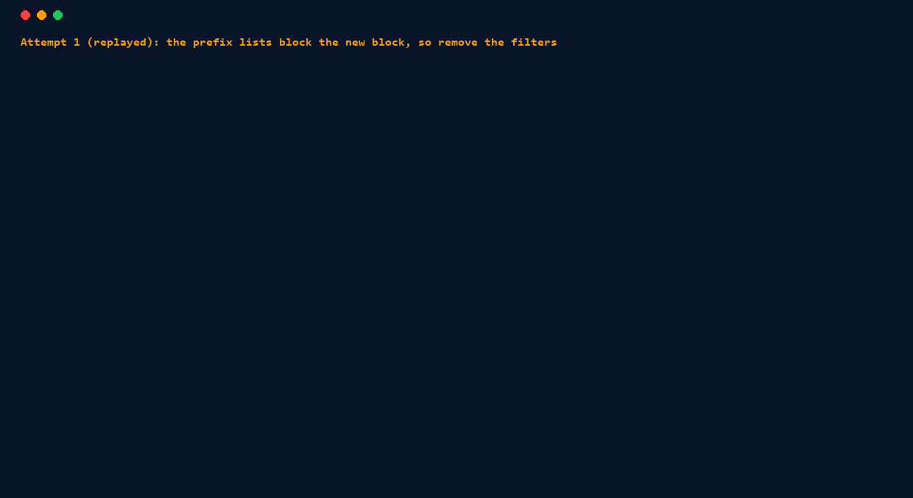

# AI agents (MCP server)

AI agents are starting to change networks. Netdryrun™ includes an [MCP](https://modelcontextprotocol.io) server that gives an agent a safety gate: it dry-runs the proposed change in a real lab and proceeds only if every check passes.

## Watch the demo

<figure class="ndr-video">
<video controls preload="none" playsinline width="1920" height="1080" poster="/assets/video/netdryrun-demo-poster.jpg" aria-label="Netdryrun demo video, about 90 seconds, captions burned in">
<source src="/assets/video/netdryrun-demo.mp4" type="video/mp4">
<track kind="captions" srclang="en" label="English (text)" src="/assets/video/netdryrun-demo.vtt">
<a href="/assets/video/netdryrun-demo.mp4">Download the video (MP4)</a>
</video>
<figcaption>About 90 seconds, captions on screen, no sound. A leaked default route that ping and session checks miss, an AI agent's tempting change rejected and the two-line fix passed (a scripted replay), a real agent run, and the verdict corpus with its losses. Every terminal line comes from a real run. <a href="/assets/video/netdryrun-demo.vtt">Captions as text</a>.</figcaption>
</figure>

## Set up the MCP server

```bash
pip install netdryrun
```

The MCP server is built in: `netdryrun mcp` starts it over stdio. The same requirements apply as for the CLI: Linux or WSL2, Docker, containerlab. The server runs labs on the machine where it runs.

### Claude Code

On Linux or inside WSL:

```bash
claude mcp add netdryrun -- netdryrun mcp
```

Add `-s project` to write the server into `.mcp.json` in the current folder, so everyone who works in that repository gets it.

On Windows, with Claude Code running on Windows and Netdryrun installed in WSL, start the server through `wsl.exe` and give the full path to `netdryrun` inside WSL:

```text
$ claude mcp add -s project netdryrun -- wsl.exe -d Ubuntu-22.04 -- /home/dmin/ndr-docs/bin/netdryrun mcp
Added stdio MCP server netdryrun with command: wsl.exe -d Ubuntu-22.04 -- /home/dmin/ndr-docs/bin/netdryrun mcp to project config
$ claude mcp get netdryrun
netdryrun:
  Scope: Project config (shared via .mcp.json)
  Status: ✓ Connected
  Type: stdio
  Command: wsl.exe
  Args: -d Ubuntu-22.04 -- /home/dmin/ndr-docs/bin/netdryrun mcp
```

(Claude Code 2.1.116. Use your own distribution name and path; `which netdryrun` inside WSL prints it.)

From Netdryrun 0.3.1, the tools accept the Windows path of a lab folder (`C:\labs\edge`) as well as the WSL one (`/mnt/c/labs/edge`); with 0.3.0, pass `/mnt/c/...`. That way the agent can pass the path its own file tools use. Before this, an agent on Windows had to translate paths itself, and in the [agent evaluation](#measured-ten-tickets-worked-unattended) a smaller model did not.

`dry_run` takes 30 seconds to several minutes. Start Claude Code with a longer tool timeout, in milliseconds, so it does not give up first:

```bash
MCP_TOOL_TIMEOUT=600000 claude
```

See [MCP tool calls time out](troubleshooting.md#mcp-tool-calls-time-out-in-the-client).

### Other MCP clients

Configure a stdio server with command `netdryrun` and argument `mcp`. Most clients take JSON like this (this is the `.mcp.json` Claude Code wrote above, with the Linux command):

```json
{
  "mcpServers": {
    "netdryrun": {
      "type": "stdio",
      "command": "netdryrun",
      "args": ["mcp"]
    }
  }
}
```

Without installing, use `"command": "uvx", "args": ["netdryrun", "mcp"]`. On Windows, use the `wsl.exe` command and arguments shown above. Set the client's tool-call timeout to at least 5 minutes.

## Workflow

1. The agent writes its proposed change into the lab's configs (in a lab folder with a containerlab topology and a `netdryrun.yml`).
2. It calls `dry_run` on that folder.
3. It applies the change elsewhere only if `status` is `passed`.

## Demo: a ticket, a tempting change, a verdict



[`examples/agent-demo`](https://github.com/netdryrun/netdryrun/tree/main/examples/agent-demo): the customer's new block must reach the upstream and the peer. The tempting change, removing the prefix-list filters, passes every ticket check, session check and ping, but leaks upstream routes and the upstream's default route to the peer, and accepts a prefix the customer doesn't own. The network team's leak guards fail, so the verdict is `DO NOT APPLY THIS CHANGE`. The proper fix, two prefix-list lines, passes the same checks. The checks never change; only the config does. Both attempts are a scripted replay (hand-written diffs, not output from a real agent); `demo.sh` runs them, and CI runs it on pushes to `main` and on pull requests. In a [real run](#a-real-agent-run), a fresh Claude Code agent with only the ticket, the lab and these MCP tools made the correct two-line change on the first try and proposed it with a `passed` verdict.

## Give the agent a ticket (the TICKET.md pattern)

An agent does better with a written task and explicit rules than with a chat message. Put a `TICKET.md` in the lab folder, next to `topology.clab.yml`, `configs/` and `netdryrun.yml`. [`examples/agent-demo/TICKET.md`](https://github.com/netdryrun/netdryrun/blob/main/examples/agent-demo/TICKET.md) is a complete example. A ticket says:

- **The goal, in network terms.** "The customer's new block 10.101.0.0/24 must reach the upstream and the peer." Name the routers, ASes and prefixes.
- **What the agent may change.** "Change only `configs/edge1.conf`." A small allowed surface makes the change easy to review.
- **What it must not change.** "Don't edit `netdryrun.yml`." The checks belong to the network team. An agent that may edit the checks can make any change pass.
- **The gate.** "Before proposing the change, run Netdryrun on this folder (`netdryrun run <folder>`, or the `dry_run` MCP tool) and include the verdict. Propose it only if the status is `passed`."

Then the prompt can stay short. The real run below used: "Work the ticket in TICKET.md in the current folder, following its rules", plus the path the MCP tools use for the folder and a request for the diff and the verdict at the end. Nothing about the solution.

More guidance for the prompt or the agent's instructions file:

- Ask for the verdict and the names of any failed checks in the final answer, so a human can review the evidence instead of the agent's reasoning.
- Tell it what to do on a failure: read `detail` for each failed check, fix the config, run again. Never weaken or delete a check; if it thinks a check is wrong, it should say so and stop.
- Don't show it the answer. In `examples/agent-demo`, the README, `changes/` and `demo.sh` contain the solution, so the real run could only see `TICKET.md`, `netdryrun.yml`, `topology.clab.yml` and `configs/`.
- A pass covers only the checks that exist. Give the agent the network team's standing guards (leak checks, `present: false` routes), not only the ticket's acceptance checks.

The repository's [`AGENTS.md`](https://github.com/netdryrun/netdryrun/blob/main/AGENTS.md) has the same rules written for agents.

## A real agent run

[`AGENT-RUN.md`](https://github.com/netdryrun/netdryrun/blob/main/examples/agent-demo/AGENT-RUN.md) records one real run on `examples/agent-demo`, not the scripted replay:

- **Agent:** Claude Code 2.1.116 in headless mode (`claude -p`). It could read and edit files and call the Netdryrun MCP tools. No shell, no web access, so its only way to test was Netdryrun.
- **What it did:** read the ticket, the router config and `netdryrun.yml`; added the new block to the two prefix lists in `configs/edge1.conf`; called `dry_run`; got `status: passed`, 14 of 14 checks, verdict `SAFE TO PROCEED`; proposed the two-line change with the verdict. 7 turns, 69 seconds.
- **Checked afterwards:** it changed only `configs/edge1.conf`, and a fresh `netdryrun run` on its folder gave `PASSED: 14 passed, 0 failed`.

The agent did not make the tempting leaky change, so this run did not show Netdryrun catching a mistake (`demo.sh` shows that). It shows the workflow end to end: the agent found the tool, ran the network team's checks through MCP, and its proposal came with a verdict from a real lab. It is one run of one model on one ticket.

## Measured: ten tickets worked unattended

One good run is an anecdote, so on 2026-10-27 we measured. [`examples/agent-eval`](https://github.com/netdryrun/netdryrun/tree/main/examples/agent-eval) has ten tickets on the two FRR example labs: changes to make, colleagues' changes to review (some fine, some leaking routes or setting the wrong attribute while sessions and pings stay up), a request that is itself a route leak, and one broken lab. Each has a hidden grader. The expected answers were [pre-registered](https://github.com/netdryrun/netdryrun/blob/main/examples/agent-eval/PREREGISTRATION.md) before anything ran. A fresh headless Claude Code agent worked each ticket alone, with only `AGENTS.md`, this page and the MCP tools: no shell, no project memory, no human.

| Agent (Claude Code 2.1.116) | Netdryrun | Solved | Misses |
|---|---|---|---|
| `claude-opus-4-7`, two runs | 0.3.0 | 10 / 10, 10 / 10 | none |
| `claude-haiku-4-5`, one run (not pre-registered: the prediction covered only the default model) | 0.3.0 | 3 / 10 | 5 ended on a Windows/WSL path mix-up (below); T09, T06 |
| `claude-haiku-4-5`, two runs (not pre-registered) | with the fixes below | 9 / 10 (8 counted strictly, see T07 in RESULTS.md), 8 / 10 | T09 both times; T10 once |

Solved means: finished unattended, the right verdict (safe, harmful or inconclusive), the right decision (apply, don't apply, rerun), no file changed that the ticket forbids, and, for a change it wrote, an independent rerun with extra hidden checks passes.

What failed, and what changed because of it:

- **Paths on Windows.** Claude Code on Windows with the server in WSL is the setup this page documents. The smaller model passed the WSL path (`/mnt/c/...`) to its Windows file tools and was refused, and Netdryrun 0.3.0 refused the Windows path. The tools now accept both.
- **A pass that covers too little (T09).** A "pure refactor" to `redistribute connected` also announces r1's link subnets. The given checks don't look at that, so Netdryrun says `passed`. The smaller model trusted the pass every time. The larger one caught it by reading the diff, not with Netdryrun. `record_baseline` would have shown it, and no agent used it. `AGENTS.md` now says a "no behavior change" ticket needs a baseline.
- **A broken lab that says `failed` (T10).** With `bgpd` off on every router, the result is `failed`, not `inconclusive`: the inconclusive rule is conservative. Failed checks that never got usable state now carry `"unready": true`. Once, the smaller model turned `bgpd` back on in a file the ticket forbade and said apply.
- **No fix-and-rerun loop.** No agent made a wrong change and then fixed it to a pass: the larger model got every change right first time. So this doesn't measure that loop.
- **A non-deterministic lab.** One wrong-looking change (a bare `network 192.168.0.0/16`) passed 5 of 8 runs. A single `passed` can be luck when the lab itself varies.

Ten small tickets written by the tool's author, two models, at most two runs each: evidence about the docs and the tool surface, not a rate. Full results, transcripts and every miss: [RESULTS.md](https://github.com/netdryrun/netdryrun/blob/main/examples/agent-eval/RESULTS.md).

## Gate agent-made pull requests in CI

An agent's own `dry_run` is a claim. Run the same checks again in CI, where the agent cannot change the result:

```yaml title=".github/workflows/network-dryrun.yml"
name: Network dry run
on:
  pull_request:
    paths:
      - "network/**"
permissions:
  contents: read
  pull-requests: write
jobs:
  dryrun:
    runs-on: ubuntu-latest
    steps:
      - uses: actions/checkout@v4
      - uses: netdryrun/netdryrun@v0.3.0
        with:
          path: network/
          pr-comment: true
```

Then, in the repository settings:

- **Make the job a required status check** on the default branch, so a failed verdict blocks the merge.
- **Protect the checks.** Add a `CODEOWNERS` line such as `network/netdryrun.yml @your-org/network-team` and require code-owner review. A PR that edits the checks then needs a human from the network team, while config-only PRs need only the green check and a normal review.
- **Keep agent PRs away from secrets.** The lab runs as root on the runner. Follow the [Action security notes](github-action.md#security-notes): no secrets in the job, no `pull_request_target`.

The PR comment lists failures first with their evidence, so the reviewer sees what the lab saw. See [GitHub Action](github-action.md) for every input.

## Tools

The server has these tools: <!-- facts:mcp_tools -->`dry_run`, `run_checks`, `record_baseline`, `validate` and `check_types`<!-- /facts:mcp_tools -->.


| Tool | Arguments | What it does |
|---|---|---|
| `dry_run` | `path`, `keep_lab` (default `false`) | Deploy the lab, run every check, destroy the lab, return the verdict. Takes 1 to 5 minutes. |
| `run_checks` | `path` | Run the checks against a lab that is already running (no deploy or destroy) |
| `record_baseline` | `topology`, `deploy` (default `true`), `wait_seconds` (default `45`) | Deploy the lab, snapshot its BGP sessions, prefix counts and routes as `netdryrun.yml` text, destroy the lab. Returns the YAML; nothing is written to disk. Like [`netdryrun record`](reference/cli.md#record) |
| `validate` | `path` | Validate `netdryrun.yml` without starting a lab |
| `check_types` | | List supported check types and their keys, to help write `netdryrun.yml` |

The server also exposes the last full JSON report as a resource, `netdryrun://report/{path}`.

## Result and verdict

`dry_run` and `run_checks` return JSON like this:

```json
{
  "status": "failed",
  "passed": 5,
  "failed": 1,
  "error": null,
  "inconclusive_reason": null,
  "lab": "ndr-frr-broken",
  "checks": [
    {"name": "r1: route 0.0.0.0/0 via bgp is absent", "passed": false,
     "detail": "unexpectedly present via bgp (not selected)"}
  ],
  "evidence_file": "/path/to/lab/netdryrun-report.json",
  "verdict": "DO NOT APPLY THIS CHANGE"
}
```

(`checks` is shortened here; the real result lists every check.)

A failed check also has `"unready": true` when every sample of it failed for lack of state: the command failed on the device, its output could not be read, or BGP had no neighbors at all. That points at the lab as much as at the change. The [inconclusive rule](reference/cli.md#when-a-run-is-inconclusive) is conservative, so a lab where a daemon never started can still come back `failed` when other nodes' route and ping checks read cleanly. If the `unready` failures and details such as `bgpd is not running` sit on nodes the change doesn't explain, report the lab problem; don't rewrite the change, and don't apply it.

`verdict` is a separate field with one of three values:

- `SAFE TO PROCEED` when `status` is `passed`
- `DO NOT APPLY THIS CHANGE` for `failed` or `error`, including config errors
- `INCONCLUSIVE: the lab did not reach a testable state; this says nothing about your change. Do not apply it until a run passes.` when `status` is `inconclusive`: the lab never came up far enough for the checks to mean anything ([rules](reference/cli.md#when-a-run-is-inconclusive)). `inconclusive_reason` says what was seen. Rerun it, perhaps with a longer `timeout`; don't rewrite the change because of it.

Tell the agent what to do with each verdict: propose the change only on `SAFE TO PROCEED`; on `DO NOT APPLY THIS CHANGE`, read the failed checks, fix the config and run again; on `INCONCLUSIVE`, rerun, and if it stays inconclusive, report that the lab does not come up instead of changing the config. [Troubleshooting](troubleshooting.md#inconclusive-the-lab-never-came-up) shows a real inconclusive run.

The full evidence is written to `netdryrun-report.json` next to `netdryrun.yml`. Its format, `netdryrun.report/v1`, is defined by a JSON Schema: [`report-v1.json`](https://netdryrun.com/schemas/report-v1.json). The test suite validates reports from real lab runs against it.

## Safety model

- **It never touches production.** The server has no tool that pushes config anywhere. It only builds and tests labs.
- **No raw device output in tool results.** Tool results contain normalized check results (name, pass/fail, a short detail), not raw command output; that goes to the JSON report file. A detail or an error can still quote a fragment of lab text, such as a BGP state name or the last line of a failed command, so each is flattened to one line and capped at 300 characters (1,000 for errors). The `status` and `verdict` are computed from pass/fail only, never from that text: an agent should act on them and treat `detail` and `error` as data.
- **Labs are code.** containerlab runs privileged containers. Only point the server at topologies you trust, on a machine you would let run Docker. The tools take any path the agent passes, and a `netdryrun.yml` can point at a topology in another folder. To keep an agent to one folder, set `NETDRYRUN_MCP_ROOT` in the server's environment (several folders separated by `:`, or `;` on Windows): every `netdryrun.yml`, the lab it points to and every topology must then resolve inside it, or the tool refuses. This stops an agent from being steered to a lab elsewhere; it does not make an untrusted lab inside the folder safe, since a topology can still mount host paths.

A pass is evidence from a lab, not a guarantee about production. See [what a lab cannot prove](trust.md#what-a-lab-cannot-prove).
